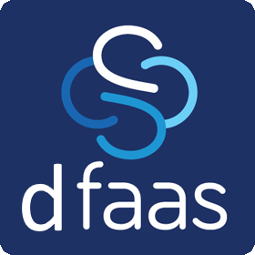
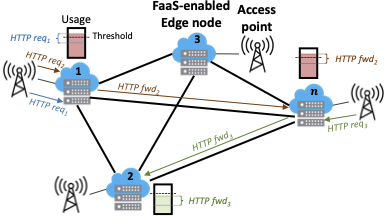
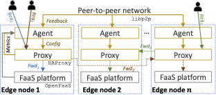

# DFaaS: Decentralized Function-as-a-Service for Federated Edge 



This repository contains DFaaS, a decentralized FaaS-based architecture designed
to automatically and autonomously balance the traffic load across edge nodes
belonging to federated Edge Computing ecosystems.

DFaaS implementation relies on an overlay peer-to-peer network and a
decentralized control algorithm that takes decisions on load redistribution.
Although preliminary, our results confirm the feasibility of the approach,
showing that the system can transparently redistribute the load across edge
nodes when they become overloaded.

Our prototype is based on OpenFaaS Community Edition, HAProxy, and Prometheus
and a custom control logic implemented in Go.

This research is conducted by the
[DatAI](https://unimib-datai.github.io/datai-website/) (formerly Insid&s) and
[NetLab](https://netlab.disco.unimib.it/) (formerly REDS) research laboratories
of the Department of Informatics, Systems and Communication (DISCo), University
of Milano-Bicocca.

If you wish to reuse this source code, please consider citing our article
describing the first prototype:

```
@inproceedings{Ciavotta_DFaaS_2021,
    author = {Ciavotta, Michele and Motterlini, Davide and Savi, Marco and Tundo, Alessandro},
    doi    = {10.1109/CloudNet53349.2021.9657141},
    pages  = {1--4},
    series = {2021 IEEE 10th International Conference on Cloud Networking (CloudNet)},
    title  = {{DFaaS: Decentralized Function-as-a-Service for Federated Edge Computing}},
    url    = {https://ieeexplore.ieee.org/document/9657141},
    year   = {2021}
}
```

## Scenario & Architecture



The above figure depicts the considered network scenario. A set of
geographically-distributed _FaaS-enabled edge nodes_ (or simply _edge nodes_) is
deployed at the edge of the access network. 

Each of these nodes deploys a _DFaaS platform_ for the execution of _serverless
functions_, and is connected to a wireless or wired _access point_ (e.g. a base
station, a broadband network gateway, a WiFi access point, etc.).

The edge node can receive functions' execution _requests_, in the form of HTTP
requests, generated by the _users_ served by the access point.

The following image summarizes the DFaaS architecture:



For more information about the architecture, see
[docs/overview.md](docs/overview.md) file.

## How to run DFaaS

**DFaaS is currently at a prototype stage.** It relies on
[HAProxy](https://www.haproxy.org/) for the proxy component, [OpenFaaS
CE](https://www.openfaas.com/) as the Function-as-a-Service platform, and
[Prometheus](https://prometheus.io/) for metrics collection. Kubernetes is the
only supported deployment environment.

The DFaaS prototype has been tested with [Ubuntu 24.04.3
LTS](https://releases.ubuntu.com/noble/) and [K3S](https://k3s.io/) as the
Kubernetes distribution.

We recommend starting with fresh virtual machines (VMs) running Ubuntu. You can
deploy one DFaaS platform per VM.

For more information about DFaaS, refer to the documentation in the
[`docs`](docs) directory.

### Deploy with just

DFaaS is deployed on the local node with [just](https://just.systems/). The node
needs:

* [buildah](https://buildah.io/), to build the images,
* [k3s](https://k3s.io/), installed with `INSTALL_K3S_EXEC="--disable traefik"`,
* [Helm](https://helm.sh/) v3 (v4 is not supported),
* [`faas-cli`](https://github.com/openfaas/faas-cli) in `/opt/bin` for OpenFaaS,
  or [`wsk`](https://github.com/apache/openwhisk-cli) in `/opt/bin` and `zip` for
  OpenWhisk.

Build the images, then deploy the whole node. `CONFIG.yaml` is the Helm values
file of the agent:

```console
$ just agent k3s
$ just forecaster k3s
$ just deploy-all CONFIG.yaml
```

See [`docs/commands.md`](docs/commands.md) for the agent's configuration, the
other deployment modes and how to deploy OpenWhisk, and
[`docs/build.md`](docs/build.md) for building the images.

You can make automatic calls to the node with k6. More information
about it in the [dedicated directory](k6).

### Deploy functions

Use `faas-cli` to deploy functions to the local DFaaS instance with OpenFaaS, or
`wsk` for OpenWhisk.

Under the `functions/` directory you can found some custom functions for
OpenFaaS and OpenWhisk. You can deploy them with `just deploy-functions`, see
[`docs/commands.md`](docs/commands.md) for this and the other deployment modes.

### Invoke a function

Each node exposes HAProxy with port `30080` on the node's IP address. Only
`http` protocol is supported. You can use any program to make a call, as
example:

```console
$ curl -i http://127.0.0.1:30080/function/figlet -d 'Hello DFaaS world!'
```

In this case we assume that you have deployed the figlet function.

### Forwarding traffic as a malicious node

You can impersonate a malicious node that is not part of the federation by
adding the header `Dfaas-Node-Id` with a value that is not a valid peer id of
the network (e.g., `Dfaas-Node-Id: malicious-id`). All of its requests will be
rejected.

### Troubleshooting

See and follow the logs of the DFaaS Agent on the local instance:

```console
$ POD=$(sudo kubectl get pods -l app=dfaas-agent -o jsonpath="{.items[0].metadata.name}")
$ sudo kubectl logs --follow $POD
```

## Emulator

Until commit 7a8512b, an emulator was available in the [emulator
directory](https://github.com/unimib-datAI/dfaas/tree/7a8512be642321dfad8638b1c422ea59f3a98b32/emulator),
allowing multiple DFaaS edge nodes to be emulated on a single machine using
Docker and [Containernet](https://containernet.github.io/). The emulator was
removed when DFaaS migrated to Kubernetes (k3s), which requires a separate VM
for each node. The recommended approach is now to run multiple VMs that can
automatically connect on a hypervisor, which is the method we currently use.

## Simulator

We also provide a simulator to test and compare different load balancing
techniques. The simulation code is available into the [simulation
directory](simulation). Data gathered by the DFaaS system used for simulation
are available [here](simulation/data).

For more information read associated [README](simulation/README.md) file.

## License

Copyright © 2021-2026 The DFaaS Authors.

Unless otherwise noted, the source code in this repository is licensed under the
GNU Affero General Public License (AGPL), version 2.0 or later. See the
[LICENSE](LICENSE) file for more information.

This program is distributed in the hope that it will be useful, but WITHOUT ANY
WARRANTY; without even the implied warranty of MERCHANTABILITY or FITNESS FOR A
PARTICULAR PURPOSE. See the GNU Affero General Public License for more details.

The complete list of The DFaaS Authors can be fond in the [AUTHORS](AUTHORS)
file or in the [contributors
page](https://github.com/unimib-datAI/dfaas/graphs/contributors) on the DFaaS
GitHub repository.
